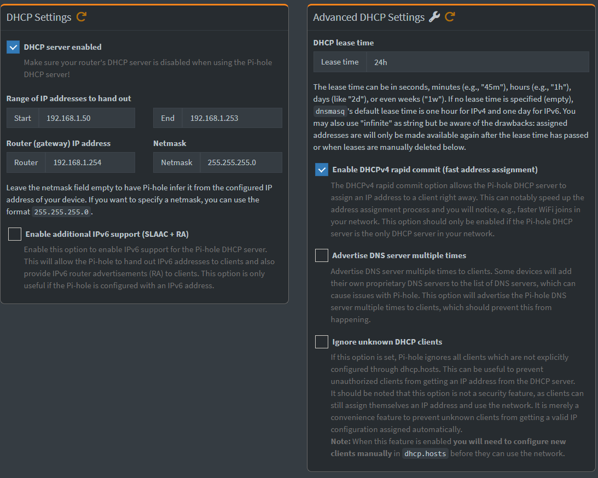
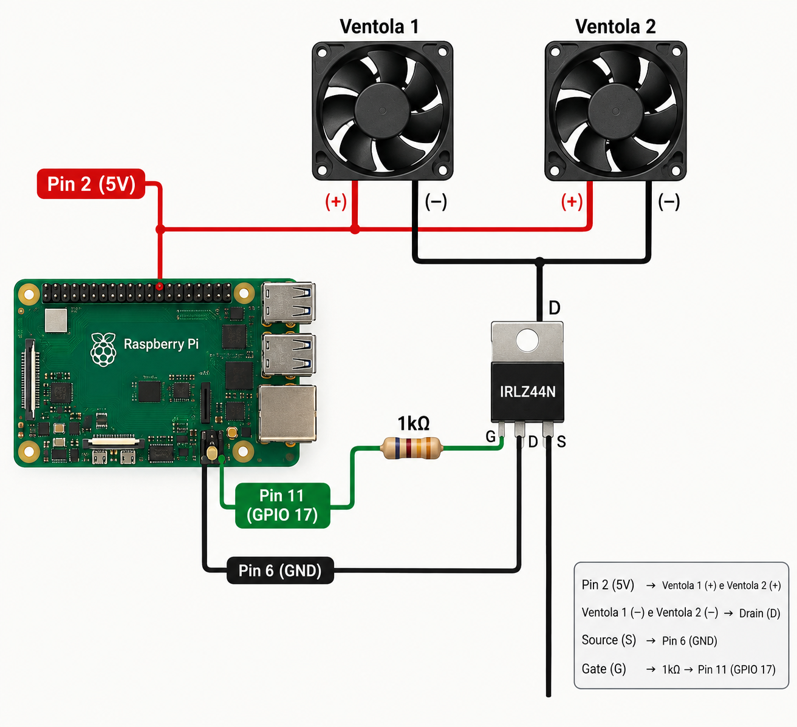
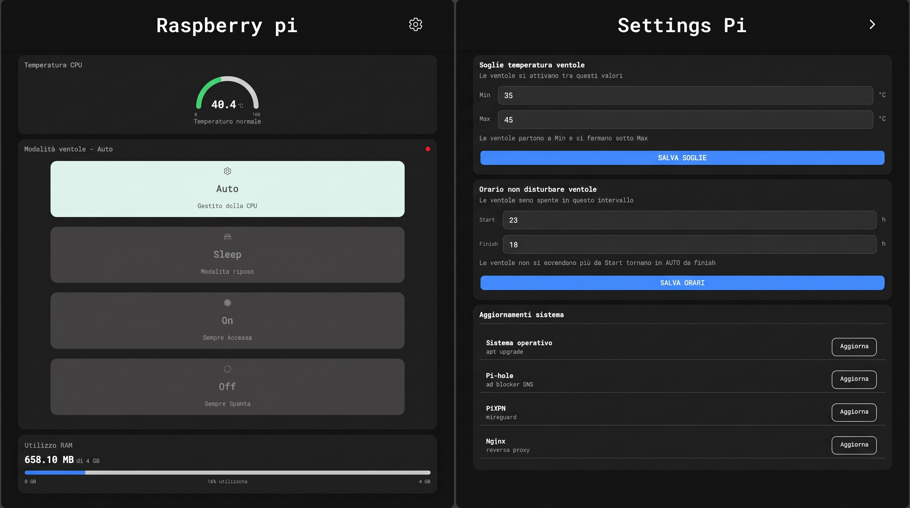

# Home Network Infrastructure

## Architecture Overview

### Network Devices
- **Router ISP (`192.168.1.1/24`)**: Gestisce la connettività WAN. DHCP disabilitato.
- **Proxmox VE (`192.168.1.11/24`)**: Hypervisor per la gestione di LXC/VM isolate.
- **Raspberry Pi 4B (`192.168.1.10/24`)**: Core network services (DNS, VPN, Reverse Proxy).

   

## Raspberry Pi 4B
*IP: 192.168.1.10/24*
### Servizi erogati:
* DNS & DHCP - PiHole 
* VPN - PiVPN WireGuard
* Reverse Proxy - Nginx
* Backend per applicazione - Dashpi **(sviluppato internamente)**

### 1. DNS & DHCP (Pi-hole)

Ho scelto di implementare questo servizio principalmente perché, attraverso la gestione DNS offerta da PiHole, è possibile applicare filtri di rete mirati. In questo modo è possibile attivare un ad-blocker a livello globale su tutta la rete e proteggere gli utenti finali (i membri della mia famiglia) dai principali siti di phishing e contraffatti. Le liste di blocco sono state integrate da [https://github.com/hagezi/dns-blocklists](https://github.com/hagezi/dns-blocklists). Un ulteriore motivo che ha reso necessario l'uso di PiHole è legato al router fornito dall'ISP, il quale non permetteva la modifica dei server DNS; per superare questa limitazione, è stato sufficiente disabilitare il servizio DHCP sul router e delegarne la gestione a PiHole.

*Impostazioni*

### 2. VPN (PiVPN / WireGuard)

Questo servizio viene utilizzato prevalentemente per accedere, gestire e modificare le risorse all'interno della rete locale in modo remoto e sicuro. Inoltre, rappresenta un fondamentale strumento di protezione dei dati personali quando ci si connette a reti Wi-Fi pubbliche.

### 3. Reverse Proxy & SSL

*N.B.: questo è l'unico servizio che, per ragioni di praticità e gestione, è stato installato tramite Docker.*

La scelta di questo servizio nasce dall'esigenza di instradare il traffico proveniente da un unico dominio verso i diversi servizi presenti all'interno della LAN. Un altro importante vantaggio è rappresentato dalla possibilità di gestire e rinnovare i certificati digitali per abilitare il protocollo sicuro HTTPS via SSL.

### 4. Backend per applicazione

Poiché il Raspberry Pi deve rimanere sempre acceso — svolgendo la funzione di server DNS, la cui assenza impedirebbe la navigazione in Internet —, è stato necessario integrare un sistema di raffreddamento attivo. Le ventole installate risultavano tuttavia molto rumorose; per ridurne l'utilizzo continuo e preservarne la durata nel tempo, sono state collegate a un transistor *MOSFET IRLZ44N* seguendo lo schema sottostante:

*\*Nota: immagine generata tramite IA, potrebbe contenere lievi imprecisioni.*

Per la gestione automatizzata del sistema, viene utilizzata un'applicazione web (ospitata sul server Proxmox) basata su due server in Python: uno dedicato al controllo delle ventole e l'altro alla gestione e all'aggiornamento del software.

**Interfaccia Utente (UI):**

   

## Server Proxmox
*IP: 192.168.1.11/24*
### Servizi erogati:
* Server WEB - WOL
* Nextcloud
* Server WEB - DashPi
* Server WEB - CV
* Server WEB - EasyBank (work in progress)

### 1. WOL (Wake-on-LAN)
Servizio gestito tramite interfaccia web che consente l'accensione e lo spegnimento remoto del mio computer personale.

**Interfaccia Utente (UI):**

### 2. Nextcloud
Piattaforma utilizzata per la gestione e la sincronizzazione sicura dei file tra diversi dispositivi. La necessità principale nasce dall'esigenza di sincronizzare localmente gli appunti presi tramite l'applicazione OneNote.

### 3. CV
Server web dedicato all'hosting e alla pubblicazione del mio curriculum vitae in formato portfolio online, raggiungibile all'indirizzo: [cloudnic.cv](https://cloudnic.cv)

### 4. EasyBank *(Work in Progress)*
Applicazione per la gestione della contabilità personale, strutturata su un database MariaDB, un backend sviluppato in Python per la logica di business e la gestione dell'API, e un frontend realizzato in TypeScript.

**Mockup:**

Shield: [![CC BY-NC 4.0][cc-by-nc-shield]][cc-by-nc]

This work is licensed under a
[Creative Commons Attribution-NonCommercial 4.0 International License][cc-by-nc].

[![CC BY-NC 4.0][cc-by-nc-image]][cc-by-nc]

[cc-by-nc]: https://creativecommons.org/licenses/by-nc/4.0/
[cc-by-nc-image]: https://licensebuttons.net/l/by-nc/4.0/88x31.png
[cc-by-nc-shield]: https://img.shields.io/badge/License-CC%20BY--NC%204.0-lightgrey.svg